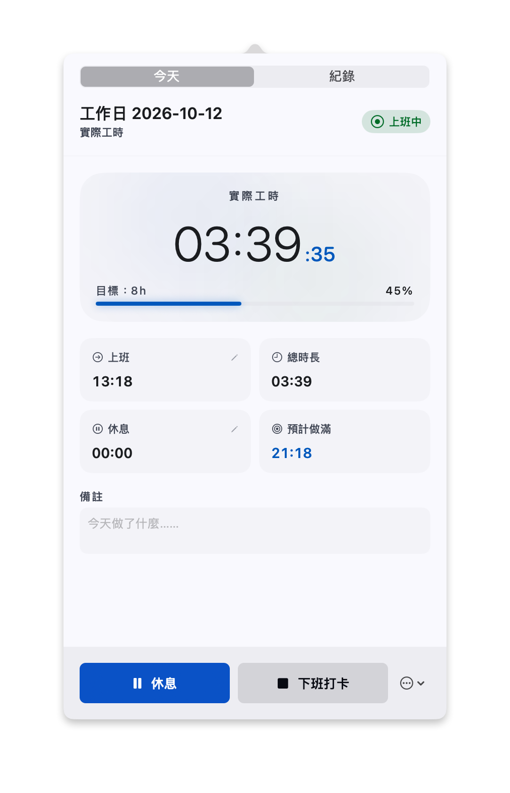
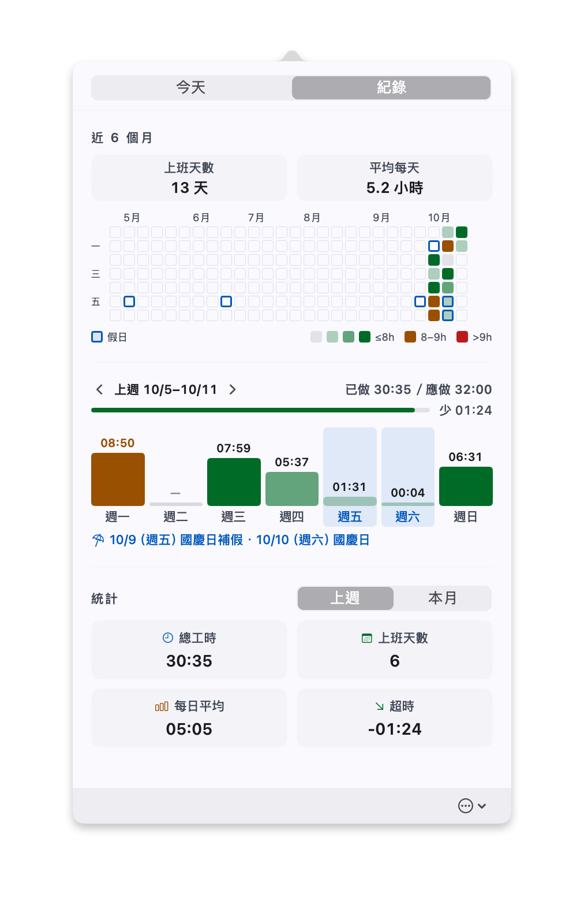

  

<h1 align="center">OpenWorktimeTracker 繁中手動打卡版</h1>

  <strong>今天到底上了幾小時班？看一眼 Mac 右上角就知道。</strong> 
  住在選單列的打卡小工具。免費、不用註冊，紀錄只存在你自己的電腦。

  <a href="https://github.com/memocubee/OpenWorktimeTracker/releases/latest"><strong>⬇️ 下載最新版</strong></a>
  &nbsp; · &nbsp;
  改自 <a href="https://github.com/64x-lunicorn/OpenWorktimeTracker">64x-lunicorn/OpenWorktimeTracker</a>

  
  

## 這是給誰的

在家工作、接案的時候，常常一坐下就做到天黑，回頭卻說不出今天做了幾個小時；月底要報工時，只能翻聊天紀錄慢慢拼回來。

這個 App 幫你記。開工按一下「上班打卡」，右上角就開始跑時間；中途離開電腦一陣子，回來時它會問你剛剛那段要算工作還是休息；收工按「下班打卡」，今天的工時就存好了。

## 能做什麼

- **手動打卡**：按「上班打卡」才開始算，早上開電腦回個訊息不會被當成上班。
- **離開電腦會問你**：講電話、開會可以算工作，去吃飯就算休息，由你決定。
- **休息時間直接改**：忘了按暫停，回來改今天的休息總長就好。
- **每週紀錄**：一週一頁，標出台灣國定假日；另外有最近 7 天的直條圖、近 6 個月的工時熱度圖。
- **快超時會變色**：預設 8 小時達標、9 小時右上角變紅，都可以自己改。
- **紀錄是你的**：存在你選的資料夾，也能匯出 CSV 用 Excel 打開。資料夾放在雲端同步夾，換電腦也看得到舊紀錄。
- **會自己更新**：出新版時跳出視窗，按「安裝更新項目」，它會自己下載、換好、重新打開。

## 安裝

需要 Apple 晶片的 Mac（M1 以後）、macOS 14 以上。Intel 晶片的 Mac 打不開。

1. 到[下載頁](https://github.com/memocubee/OpenWorktimeTracker/releases/latest)下載 `OpenWorktimeTracker-zh-版本號.dmg`。
2. 打開下載的檔案，把 OpenWorktimeTracker 拖到旁邊的「應用程式」資料夾。
3. 打開 App。第一次會跳出「無法驗證」的警告，先按「完成」關掉，再到「系統設定 → 隱私權與安全性」往下捲，在 OpenWorktimeTracker 那一行按「仍要打開」。
4. 右上角選單列出現時間後，點開它，按「上班打卡」就開始了。

> 第一次會被擋，是因為這是個人改版，沒有向蘋果申請開發者認證。原始碼都公開在這一頁，可以自己檢查。

想把紀錄存到別的地方：點開右上角 → 按「⋯」圓形按鈕 →「設定…」→「選擇紀錄資料夾…」。

## 更新

App 每天會連到 GitHub 看一次有沒有新版本。有的話會跳出視窗，按「安裝更新項目」，它會自己下載、換好、重新打開，以前的紀錄和設定都會留著。在那個視窗勾「自動下載並安裝更新項目」，以後就在背景下載好，下次 App 關掉或電腦重開時自動換上。

- 想馬上查：點開右上角 → 按「⋯」→「檢查更新…」
- 不想自動檢查：「設定…」→「資料」分頁最下面關掉
- App 只會下載版本資訊和新版程式，不會上傳你的紀錄；每一版都有簽名，確認是這裡發的才會安裝

> 0.7.8 以前的版本還不會自己更新，請手動換一次：先在面板按「⋯」→「結束程式」，下載最新版，把 App 拖進「應用程式」、選「取代」。之後就會自己更新了。

## 跟原版差在哪

這是 [64x-lunicorn/OpenWorktimeTracker](https://github.com/64x-lunicorn/OpenWorktimeTracker) 的個人改版。原版是英文、德文介面，開電腦就自動開始算。這一版改了：

- 繁體中文介面
- 預設手動打卡（設定裡可以關掉，改回自動開始）
- 自動更新改成接這一版自己的新版本，不會被原版的英文版蓋掉
- 紀錄頁改成每週檢視、加上台灣國定假日，統計加了直條圖和熱度圖

想用原版或看英文說明，請到原作者的頁面。

## 授權

跟原版一樣採用 GPL-3.0：可以自由使用、修改、分享，分享改過的版本時也要公開原始碼。全文見 [LICENSE](LICENSE)。謝謝原作者 64x-lunicorn 把這個 App 開源出來。
